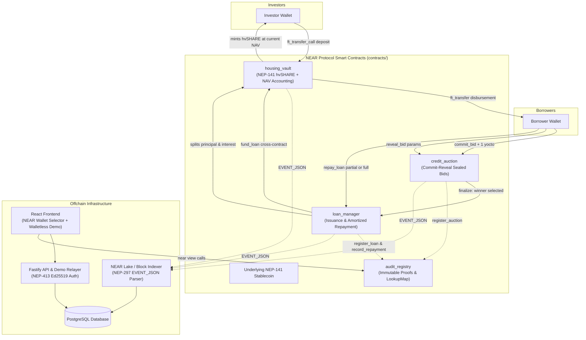

# HOMR — Fully NEAR-Native Decentralized Housing Credit Infrastructure

HOMR is an institutional-grade, Indonesia-focused decentralized housing-credit platform built 100% natively on **NEAR Protocol**.

Investors deposit NEP-141 stablecoins into a liquidity vault that issues dynamic NAV-bearing `hvSHARE` tokens. Pre-underwritten borrowers compete for credit allocation through a sealed-bid **commit-reveal auction**. Capital allocation, loan management, and amortized repayments are enforced onchain with immutable compliance proofs queryable directly on NEAR.



---

## Architecture Overview

All smart contracts are written in idiomatic Rust using `near-sdk v5.17+` with strict safety controls:
* **`contracts/credit_auction`**: Commit-reveal sealed bidding with monotonic `auction_id` sequence, zero unbounded storage loops, and 1 yocto deposit guards.
* **`contracts/housing_vault`**: NEP-141 vault share token (`hvSHARE`) with real-time Net Asset Value (NAV) appreciation as interest repayments accrue.
* **`contracts/loan_manager`**: Lifecycle manager for loan issuance, cross-contract capital disbursement from vault, and amortized partial repayments.
* **`contracts/audit_registry`**: High-performance immutable proof storage backed by `near_sdk::store::LookupMap` with trusted contract access control.
* **`contracts/common`**: Shared NEP-297 event utilities, proof schemas, and cryptographic commitment hashing functions.
* **`contracts/mock_token`**: Standalone NEP-141 test stablecoin implementation for local sandbox testing.

*Note: The original EVM/BNB Chain prototype code has been retired and preserved under `legacy/`.*

---

## Directory Layout

```
homr-near/
├── contracts/               # NEAR Rust Workspace
│   ├── common/              # Shared types, NEP-297 event emitter, crypto utils
│   ├── audit_registry/      # Immutable proof registry (LookupMap)
│   ├── credit_auction/      # Commit-reveal auction
│   ├── housing_vault/       # Liquidity vault & NEP-141 hvSHARE
│   ├── loan_manager/        # Loan issuance & repayments
│   └── mock_token/          # Test NEP-141 stablecoin
├── api/                     # Fastify backend, NEAR indexer, and demo relayer
├── frontend/                # React Vite app with NEAR Wallet Selector
├── legacy/                  # Deprecated EVM Solidity baseline (archival only)
├── MIGRATION_PLAN.md        # Comprehensive migration roadmap & tracking
└── README.md
```

---

## Local Development & Testing

### 1. Build and Test Smart Contracts
```bash
# Check and test all contracts
cargo test --workspace

# Build WebAssembly contract binaries
cargo build --target wasm32-unknown-unknown --release
```

### 2. Run API & Indexer
```bash
cd api
npm install
npm run dev
```

### 3. Run Frontend
```bash
cd frontend
npm install
npm run dev
```

---

## Security & Design Guarantees

1. **State Scaling**: Strictly prohibits `std::collections::HashMap` for contract state. All persistent data structures utilize `near_sdk::store::LookupMap` and `Vector`.
2. **Safe Math**: All release profiles enforce `overflow-checks = true`. Financial quantities use 128-bit unsigned integers (`U128`).
3. **Promise Safety**: All cross-contract callback methods are annotated with `#[private]` and strictly check `env::current_account_id() == env::predecessor_account_id()`.
4. **Transparent Auditability**: State transitions emit standardized NEP-297 `EVENT_JSON:` logs consumed directly by the indexer without ABI requirements.

---

## License
MIT
